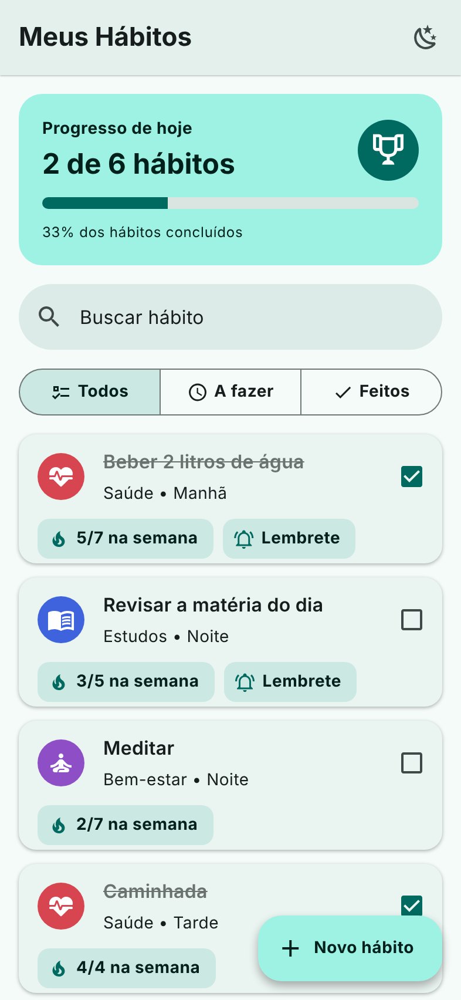
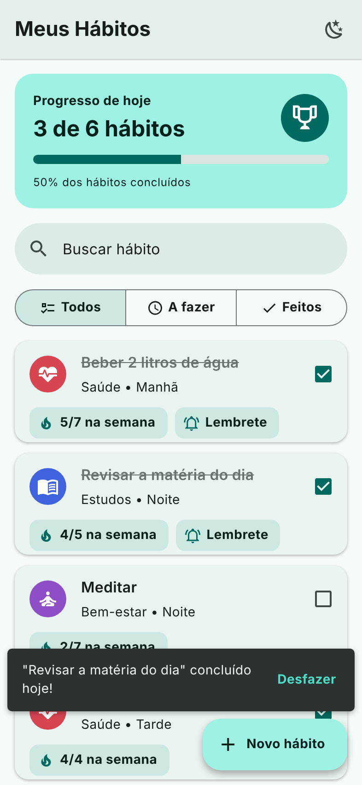
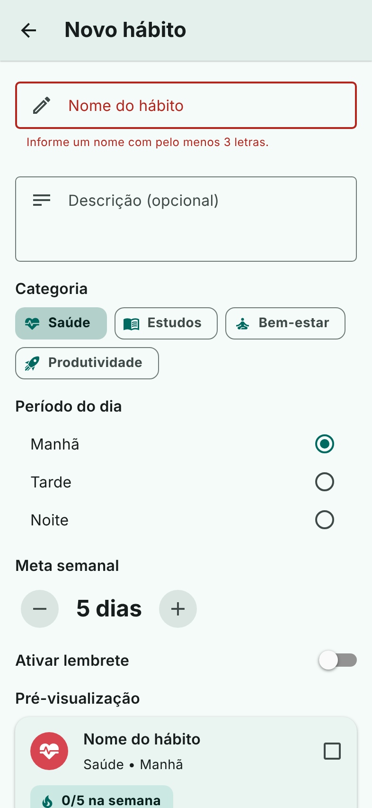
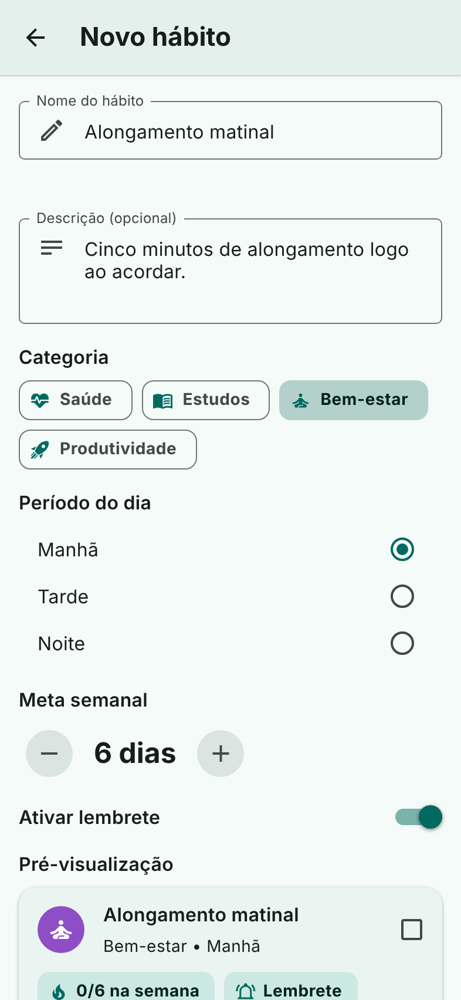
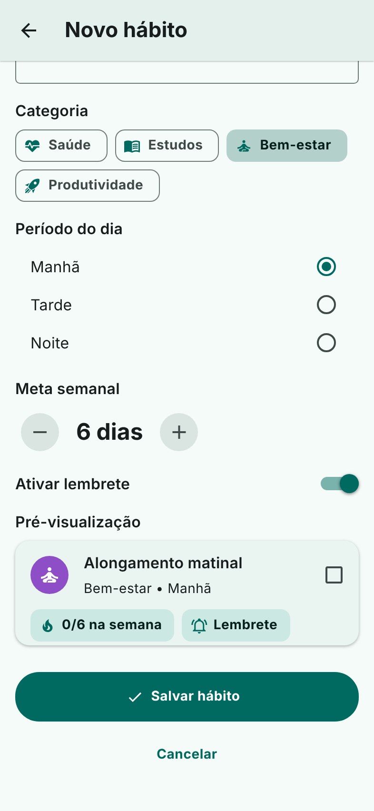
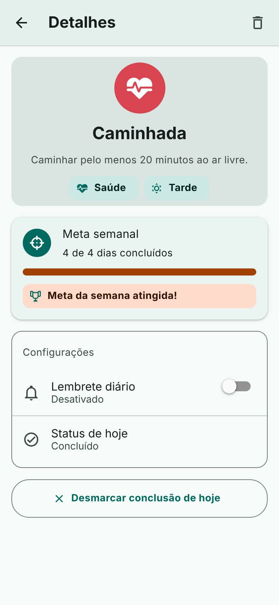
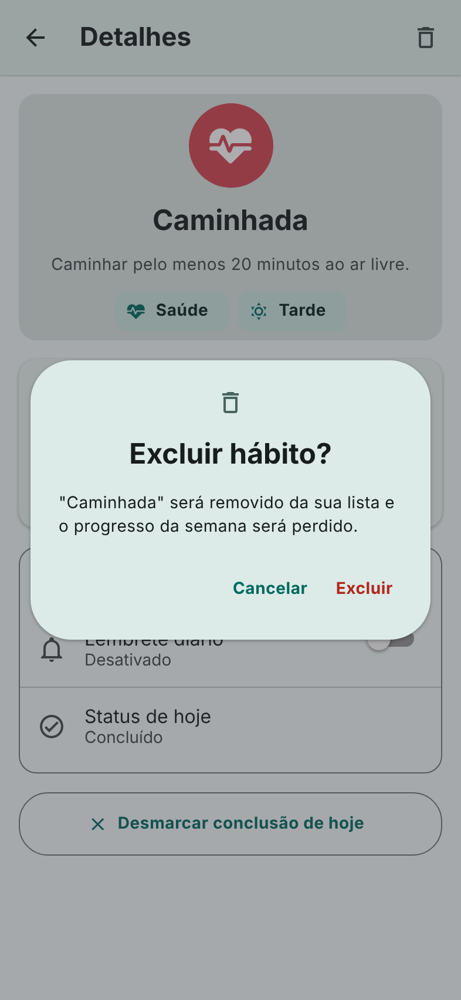
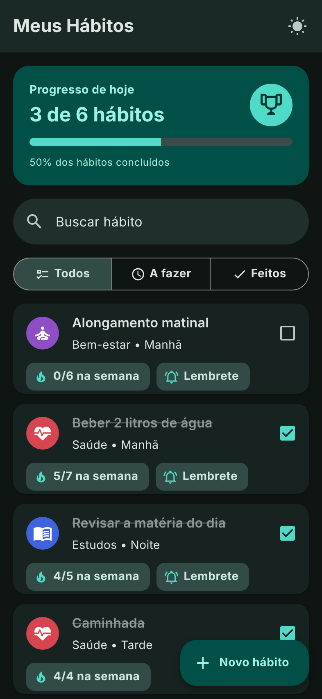
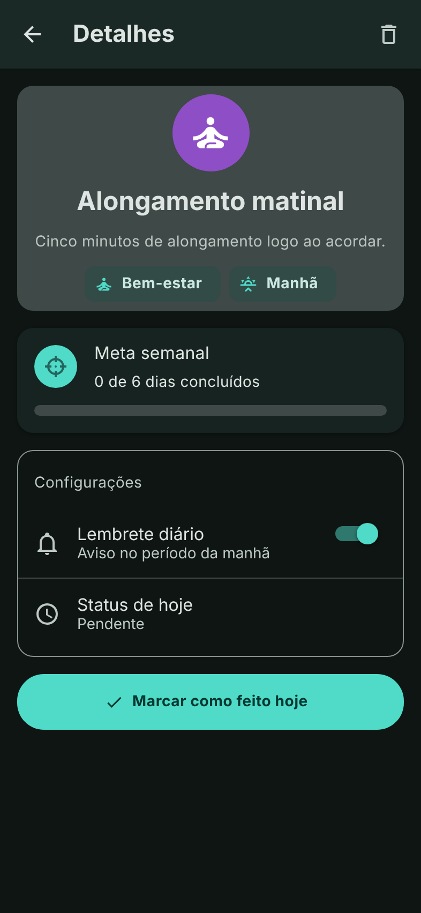

# Rastreador de Hábitos com React Native Paper

**Disciplina:** Desenvolvimento de Aplicativos Móveis Avançado
**Professor:** Renato de Sousa Gomide
**Curso:** Técnico Integrado em Informática para Internet
**Aluno:** _seu nome aqui_

**Atividade:** Bibliotecas de componentes visuais de terceiros
**Biblioteca escolhida:** [react-native-paper](https://callstack.github.io/react-native-paper)

---

## Parte 1 – Pesquisa

> Dados de versão, estrelas e downloads consultados em 14/11/2026.

### 1. Identificação

| Item | Informação |
| --- | --- |
| Nome | React Native Paper (`react-native-paper`) |
| Documentação oficial | https://callstack.github.io/react-native-paper |
| Repositório | https://github.com/callstack/react-native-paper |
| Página no npm | https://www.npmjs.com/package/react-native-paper |
| Licença | MIT (uso livre, inclusive comercial, mantendo o aviso de copyright) |

### 2. Manutenção e última versão

- **Quem mantém:** a [Callstack](https://www.callstack.com/), empresa especializada em React Native, que patrocina o projeto. O código é aberto e recebe contribuições da comunidade.
- **Última versão estável:** `5.15.4`, publicada em **02/11/2026** no npm.
- **Atividade recente:** em 2026 foram publicadas as versões 5.15.1 (abril), 5.15.2 e 5.15.3 (maio) e 5.15.4 (novembro). A versão 6 está em pré-lançamento (`6.0.0-alpha.2`, de 09/11/2026). Ou seja, a biblioteca recebeu atualização nos últimos 12 meses.

### 3. Popularidade

| Métrica | Valor |
| --- | --- |
| Estrelas no GitHub | cerca de **14,5 mil** (≈ 2,2 mil forks) |
| Downloads semanais no npm | **606.895** (semana de 07/11/2026 a 13/11/2026) |

### 4. Plataformas suportadas e compatibilidade com o Expo

| Plataforma | Suporte |
| --- | --- |
| Android | Sim (oficial) |
| iOS | Sim (oficial, seguindo as diretrizes de adaptação do Material Design) |
| Web | Sim, via `react-native-web` (testado neste projeto com `npx expo start --web`) |

**Expo:** a biblioteca é escrita somente em JavaScript/TypeScript. Suas dependências nativas (`react-native-safe-area-context` e a fonte de ícones do `@expo/vector-icons`) já vêm incluídas no **Expo Go**. Por isso ela **funciona no Expo Go e não exige development build**.

### 5. Instalação e configuração

```bash
npx expo install react-native-paper react-native-safe-area-context @expo/vector-icons
```

Configurações necessárias:

1. Envolver o aplicativo no `PaperProvider`, que distribui o tema para todos os componentes. Os componentes `Dialog`, `Snackbar` e `Portal` também dependem dele.
2. Envolver a aplicação no `SafeAreaProvider`, porque o `Appbar.Header` usa as áreas seguras da tela.
3. **Opcional:** adicionar o plugin `react-native-paper/babel` no ambiente de produção do `babel.config.js`, para importar só os componentes usados e diminuir o bundle.
4. Não é preciso nenhum plugin no `app.json`.

```jsx
import { PaperProvider } from 'react-native-paper';
import { SafeAreaProvider } from 'react-native-safe-area-context';

export default function App() {
  return (
    <SafeAreaProvider>
      <PaperProvider theme={meuTema}>
        <Rotas />
      </PaperProvider>
    </SafeAreaProvider>
  );
}
```

### 6. Principais componentes

| Componente | Descrição |
| --- | --- |
| `Appbar` | Barra superior com título, botão de voltar (`Appbar.BackAction`) e ações com ícones (`Appbar.Action`). |
| `Card` | Cartão com título, subtítulo, avatar, conteúdo e ações. Tem as variações `elevated`, `outlined` e `contained`. |
| `TextInput` | Campo de texto nos modos `flat` e `outlined`, com rótulo animado, ícones e estado de erro. Pode ser combinado com o `HelperText`. |
| `Button` | Botão com os modos `contained`, `outlined`, `text`, `elevated` e `contained-tonal`, com ícone e estado de carregamento. |
| `FAB` | Botão de ação flutuante. Pode ser estendido com rótulo ou virar um grupo de ações (`FAB.Group`). |
| `Dialog` + `Portal` | Caixa de diálogo modal (título, ícone, conteúdo e ações), renderizada por cima de toda a tela pelo `Portal`. |
| `Snackbar` | Mensagem temporária na parte inferior da tela, com um botão de ação opcional (por exemplo, "Desfazer"). |
| `SegmentedButtons` | Grupo de botões segmentados para escolher uma opção ou várias, muito usado como filtro. |
| `Chip` | Etiqueta compacta e selecionável, com ícone. |
| `List` | Itens de lista com título, descrição e ícones (`List.Item`), agrupados em seções (`List.Section`). |
| `Searchbar`, `Switch`, `Checkbox`, `RadioButton`, `ProgressBar` | Campo de busca, interruptor, caixa de seleção, botão de opção e barra de progresso, todos já seguindo o tema. |

### 7. Personalização da aparência

- **Tema global:** o objeto passado para o `PaperProvider` define as cores (`colors`), o arredondamento das bordas (`roundness`), a tipografia (`fonts`) e o modo escuro (`dark`). O ideal é estender os temas prontos `MD3LightTheme` e `MD3DarkTheme` e trocar só o que for preciso.
- **Tipografia:** a função `configureFonts` altera família, peso e espaçamento de cada variante de texto (`titleLarge`, `bodyMedium` etc.).
- **Tema escuro:** basta trocar o tema passado ao `PaperProvider`. Todos os componentes se atualizam juntos.
- **Integração com a navegação:** `adaptNavigationTheme` converte o tema do Paper para o formato do React Navigation, para que o fundo das telas siga as mesmas cores.
- **Acesso ao tema:** o hook `useTheme()` devolve as cores do tema atual para usar em estilos próprios.
- **Props de cada componente:** `mode`, `icon`, `color`, `buttonColor`, `textColor`, `compact`, `elevation`, além de `style`, `contentStyle` e `labelStyle`. Também dá para passar a prop `theme` a um único componente para sobrescrever o tema só nele.

Trecho do tema usado neste projeto (`src/theme/tema.js`):

```js
export const temaClaro = {
  ...MD3LightTheme,
  roundness: 5,
  fonts: configureFonts({ config: { titleLarge: { fontWeight: '700' } } }),
  colors: { ...MD3LightTheme.colors, primary: '#006A60', primaryContainer: '#9EF2E4' },
};
```

### 8. Pontos positivos e negativos observados durante o uso

**Positivos**

- Instalação simples e funcionamento direto no Expo Go, sem development build.
- Grande variedade de componentes com o mesmo padrão visual (Material Design 3). Deu para montar o formulário inteiro sem criar nenhum componente visual do zero.
- O tema centralizado permitiu trocar a paleta inteira e ativar o modo escuro alterando só o objeto passado ao `PaperProvider`.
- Integração simples com o React Navigation usando `adaptNavigationTheme`.
- Documentação organizada, com exemplos e a tabela de props de cada componente. Tem suporte a TypeScript.
- Componentes com acessibilidade pronta (por exemplo, `Appbar.BackAction` já vem com rótulo de acessibilidade).

**Negativos**

- O visual é muito "Material/Android". Para fugir do padrão foi preciso sobrescrever cerca de 30 tokens de cor, incluindo os níveis de `elevation`; sem isso, os cartões continuavam com o tom roxo do tema padrão.
- O `Checkbox` muda de aparência conforme a plataforma: no iOS ele mostra só o "✓", sem a caixa, e por isso o estado desmarcado fica invisível. Foi necessário usar `Checkbox.Android` para manter a caixa em todas as plataformas.
- Na web, o `ProgressBar` ocupa 100% da altura do componente pai e empurrou os textos seguintes para baixo. A solução foi envolvê-lo numa `View` de altura fixa (componente `BarraProgresso`).
- Rótulos longos no `SegmentedButtons` são cortados em telas estreitas ("Pendentes" aparecia como "Pende…"), então foi preciso encurtá-los.
- A fonte de ícones MaterialCommunityIcons acrescenta cerca de 1,3 MB ao aplicativo.
- A versão 6 está em fase alpha, o que indica mudanças de API em breve.

### 9. Comparação com uma alternativa: React Native Elements

| Critério | React Native Paper | React Native Elements (`@rneui/themed`) |
| --- | --- | --- |
| Estilo visual | Material Design 3 | Visual próprio e neutro |
| Última versão | 5.15.4 (02/11/2026) | 5.0.0 (19/01/2026) |
| Estrelas no GitHub | ≈ 14,5 mil | ≈ 25,9 mil |
| Downloads semanais no npm | ≈ 607 mil | ≈ 67 mil |
| Instalação | `react-native-paper` | `@rneui/themed` + `@rneui/base` |
| Temas | `PaperProvider` com tokens MD3, modo escuro e `adaptNavigationTheme` | `ThemeProvider` + `createTheme`, com estilos por componente |
| Expo Go | Funciona | Funciona |
| Componentes | Appbar, Snackbar, SegmentedButtons, FAB, Dialog, Searchbar e outros | Header, ButtonGroup, SpeedDial, Overlay, Rating, SearchBar e outros |

**Justificativa da escolha:** as duas bibliotecas resolvem o mesmo problema (um kit de componentes prontos) e funcionam no Expo Go. Escolhi o React Native Paper por quatro motivos:

1. É mantido por uma empresa e teve lançamentos frequentes em 2026. O pacote `@rneui/themed` ficou de julho de 2023 a novembro de 2025 sem nenhuma versão nova, e a 5.0.0 (janeiro de 2026) foi a sua primeira versão estável.
2. Tem quase 10 vezes mais downloads semanais, o que indica mais uso atual e mais material de apoio.
3. Segue uma especificação de design completa (Material Design 3), então o aplicativo fica consistente sem esforço extra.
4. Oferece componentes que foram úteis no projeto e que o React Native Elements não tem prontos, como o `Snackbar` com ação de desfazer.

O React Native Elements tem mais estrelas por ser mais antigo e um visual mais neutro, o que seria vantagem num aplicativo que não quisesse a aparência do Material Design.

### Fontes

- Documentação oficial do React Native Paper: https://callstack.github.io/react-native-paper
- Guia de instalação: https://callstack.github.io/react-native-paper/docs/guides/getting-started
- Guia de temas: https://callstack.github.io/react-native-paper/docs/guides/theming
- Temas com React Navigation: https://callstack.github.io/react-native-paper/docs/guides/theming-with-react-navigation
- Repositório no GitHub: https://github.com/callstack/react-native-paper
- Página no npm: https://www.npmjs.com/package/react-native-paper
- Downloads semanais (API do npm): https://api.npmjs.org/downloads/point/last-week/react-native-paper
- Lançamento da versão 5.0 (Material You / MD3): https://callstack.com/blog/react-native-paper-5-0
- React Native Elements (documentação): https://reactnativeelements.com
- React Native Elements (GitHub): https://github.com/react-native-elements/react-native-elements
- React Native Elements (npm): https://www.npmjs.com/package/@rneui/themed
- Downloads semanais do `@rneui/themed`: https://api.npmjs.org/downloads/point/last-week/@rneui/themed

---

## Parte 2 – Projeto de exemplo

### Sobre o aplicativo

O **Rastreador de Hábitos** ajuda a acompanhar hábitos diários (beber água, estudar, meditar etc.). Com ele é possível:

- ver o progresso do dia;
- buscar e filtrar hábitos;
- marcar um hábito como feito, com opção de desfazer;
- cadastrar novos hábitos com pré-visualização em tempo real;
- ver os detalhes e a meta semanal de cada hábito;
- ativar lembretes;
- excluir hábitos;
- alternar entre tema claro e escuro.

A navegação usa o `@react-navigation/native-stack`, visto em aula, apenas como suporte. A biblioteca analisada é a `react-native-paper`.

### Como executar

Pré-requisitos: [Node.js](https://nodejs.org) 22.13 ou superior e o aplicativo **Expo Go** atualizado no celular (o projeto usa o Expo SDK 58).

```bash
git clone <url-do-repositorio>
cd rastreador-habitos
npm install
npx expo start
```

Depois disso:

- **Android:** abra o Expo Go e leia o QR Code exibido no terminal.
- **iOS:** leia o QR Code com a câmera do iPhone.
- **Emulador Android:** pressione `a` no terminal.
- **Navegador:** pressione `w` no terminal.

### Estrutura de pastas

```
rastreador-habitos/
├── App.js                        # Providers (SafeArea, tema, Paper, hábitos, navegação)
├── index.js
├── app.json
├── docs/capturas/                # Capturas de tela usadas neste README
└── src/
    ├── components/
    │   ├── BarraProgresso.js
    │   ├── HabitoCard.js
    │   └── ResumoDoDia.js
    ├── contexts/
    │   ├── HabitosContext.js     # Estado da lista de hábitos (useState)
    │   └── TemaContext.js
    ├── data/
    │   ├── habitosIniciais.js    # Vetor local de dados
    │   └── opcoes.js             # Categorias e períodos
    ├── navigation/
    │   └── Rotas.js              # Stack com as 3 telas
    ├── screens/
    │   ├── ListaHabitosScreen.js
    │   ├── NovoHabitoScreen.js
    │   └── DetalhesHabitoScreen.js
    └── theme/
        └── tema.js               # Temas claro e escuro personalizados
```

### Como cada requisito foi atendido

| # | Requisito | Onde está |
| --- | --- | --- |
| 1 | Executa com `npx expo start` após `npm install` | Projeto Expo SDK 58, sem dependências que exijam development build (roda no Expo Go) |
| 2 | Pelo menos 5 componentes da biblioteca | Mais de 20 componentes, listados na tabela abaixo |
| 3 | Pelo menos 2 telas com navegação | 3 telas (Lista → Novo hábito / Detalhes) em `src/navigation/Rotas.js` |
| 4 | Formulário/interação com `useState` refletida nos componentes | `NovoHabitoScreen.js`: os estados do formulário atualizam a pré-visualização (`Card`, `Chip`, `Avatar`) em tempo real. `ListaHabitosScreen.js`: o `Checkbox` atualiza o `ProgressBar` e mostra o `Snackbar`. `DetalhesHabitoScreen.js`: `Switch` e `Dialog` |
| 5 | Lista de dados com componentes da biblioteca | Vetor de `src/data/habitosIniciais.js`, exibido em `FlatList` com `Card` (`HabitoCard.js`) |
| 6 | Personalização visual além do padrão | `src/theme/tema.js`: paleta verde-azulada, `roundness`, tipografia com `configureFonts`, tema escuro alternável e estilos via props |
| 7 | Código organizado em pastas | `screens/`, `components/`, `contexts/`, `data/`, `navigation/`, `theme/` |
| 8 | README com instruções, componentes e capturas | Esta seção |

### Componentes da biblioteca utilizados

| Componente | Arquivo(s) |
| --- | --- |
| `PaperProvider` | `App.js` |
| `MD3LightTheme`, `MD3DarkTheme`, `configureFonts`, `adaptNavigationTheme` | `src/theme/tema.js` |
| `Appbar` (`Header`, `Content`, `Action`, `BackAction`) | `src/screens/ListaHabitosScreen.js`, `src/screens/NovoHabitoScreen.js`, `src/screens/DetalhesHabitoScreen.js` |
| `Card` (`Card.Title`, `Card.Content`) | `src/components/HabitoCard.js`, `src/screens/DetalhesHabitoScreen.js` |
| `Avatar.Icon` | `src/components/HabitoCard.js`, `src/components/ResumoDoDia.js`, `src/screens/DetalhesHabitoScreen.js` |
| `Checkbox` (`Checkbox.Android`) | `src/components/HabitoCard.js` |
| `Chip` | `src/components/HabitoCard.js`, `src/screens/NovoHabitoScreen.js`, `src/screens/DetalhesHabitoScreen.js` |
| `Surface` | `src/components/ResumoDoDia.js` |
| `ProgressBar` | `src/components/BarraProgresso.js` (usado em `ResumoDoDia.js` e `DetalhesHabitoScreen.js`) |
| `Text` | `src/components/ResumoDoDia.js`, `src/screens/*` |
| `Searchbar` | `src/screens/ListaHabitosScreen.js` |
| `SegmentedButtons` | `src/screens/ListaHabitosScreen.js` |
| `FAB` | `src/screens/ListaHabitosScreen.js` |
| `Snackbar` | `src/screens/ListaHabitosScreen.js` |
| `TextInput` (`TextInput.Icon`) | `src/screens/NovoHabitoScreen.js` |
| `HelperText` | `src/screens/NovoHabitoScreen.js` |
| `RadioButton` (`RadioButton.Group`, `RadioButton.Item`) | `src/screens/NovoHabitoScreen.js` |
| `IconButton` | `src/screens/NovoHabitoScreen.js` |
| `Switch` | `src/screens/NovoHabitoScreen.js`, `src/screens/DetalhesHabitoScreen.js` |
| `Button` | `src/screens/NovoHabitoScreen.js`, `src/screens/DetalhesHabitoScreen.js` |
| `List` (`Section`, `Subheader`, `Item`, `Icon`) | `src/screens/DetalhesHabitoScreen.js` |
| `Divider` | `src/screens/DetalhesHabitoScreen.js` |
| `Dialog` (`Icon`, `Title`, `Content`, `Actions`) + `Portal` | `src/screens/DetalhesHabitoScreen.js` |
| `useTheme` (hook) | `src/components/ResumoDoDia.js`, `src/screens/DetalhesHabitoScreen.js` |

### Capturas de tela

| Lista de hábitos | Hábito marcado (Snackbar) | Validação do formulário |
| :---: | :---: | :---: |
|  |  |  |

| Formulário preenchido | Pré-visualização e salvar | Detalhes do hábito |
| :---: | :---: | :---: |
|  |  |  |

| Diálogo de exclusão | Tema escuro – lista | Tema escuro – detalhes |
| :---: | :---: | :---: |
|  |  |  |
